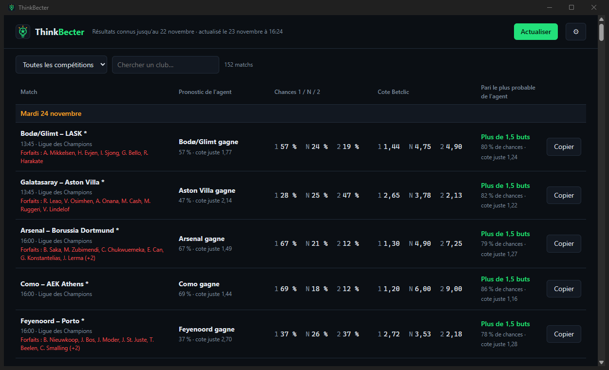

<p align="center"></p>

# ThinkBecter

Un agent de pronostics football pour Windows. Il estime les chances de chaque match des 5 grands championnats
(Premier League, Liga, Bundesliga, Serie A, Ligue 1) et, en option, des coupes d'Europe, puis les affiche sur un seul écran.



> **À lire avant de t'en servir.** Cet agent donne un avis statistique, pas un moyen de gagner de l'argent.
> Mesuré sur 2 297 matchs jamais utilisés pour le régler, il est au niveau des cotes des bookmakers
> (les chiffres sont plus bas), sans avantage prouvé. Sur la durée, parier fait perdre la marge du bookmaker.
> Jeu réservé aux adultes. Besoin d'aide : Joueurs Info Service, 09 74 75 13 13 (appel non surtaxé).

## Installation (5 minutes)

Il te faut un PC sous Windows 10 ou 11 et une connexion internet.

1. **Télécharge l'appli.** Sur cette page, clique sur le bouton vert **Code**, puis sur **Download ZIP**.
2. **Extrais le ZIP.** Clic droit sur le fichier téléchargé, puis **Extraire tout…**. Ne lance rien depuis l'intérieur du ZIP.
3. **Installe Python, si tu ne l'as pas.** Va sur [python.org/downloads/windows](https://www.python.org/downloads/windows/),
   installe Python (version **3.13** conseillée) et coche la case **Add python.exe to PATH** pendant l'installation.
4. **Lance l'appli.** Dans le dossier extrait, double-clique sur **`Lancer_Agent.bat`**.

Au premier lancement, une fenêtre noire installe les composants (1 à 3 minutes, une seule fois). L'appli s'ouvre ensuite
et télécharge ses données (moins d'une minute). Les fois suivantes, elle s'ouvre directement.

Si Windows affiche « Windows a protégé votre ordinateur », clique sur **Informations complémentaires**, puis sur
**Exécuter quand même** : c'est l'avertissement habituel pour un fichier téléchargé.

Tout reste dans le dossier de l'appli : pour la désinstaller, supprime simplement ce dossier.

## Ce que montre l'écran

| Colonne | Ce que c'est |
|---|---|
| **Match** | Les deux équipes, l'heure (celle de ton PC) et la compétition. Le logo de chaque club, le compte à rebours jusqu'au coup d'envoi, et en rouge les joueurs forfaits (clé API-Football). Quand la composition est publiée (environ 1 h avant le match, clé API-Football), un bouton **Compo** apparaît. |
| **Pronostic de l'agent** | Le résultat le plus probable (victoire à domicile, nul ou victoire à l'extérieur) et sa chance. |
| **Chances 1 / N / 2** | 1 = victoire de l'équipe à domicile, N = match nul, 2 = victoire de l'équipe à l'extérieur. |
| **Cote Betclic** | Affichée seulement si tu as mis la clé The Odds API. Pour comparer : l'agent ne s'en sert pas dans son calcul. |
| **Pari le plus probable** | Le pari qui a le plus de chances de passer, parmi le 1N2 et les plus/moins de 1,5, 2,5 et 3,5 buts. |
| **Copier** | Copie le pari dans le presse-papiers, pour le coller où tu veux. |

- **Cote juste** : la cote à partir de laquelle le pari ne perd plus d'argent sur la durée, si l'agent a raison.
- **Astérisque `*`** : estimation grossière (match de coupe d'Europe, ou club promu encore peu connu). À prendre avec prudence.
- **Actualiser** : met à jour les résultats, le calendrier et les cotes. Une fois par jour suffit.
- En haut, l'appli indique jusqu'à quelle date elle connaît les résultats. Sa source les publie une à deux fois par semaine.

## Les deux clés facultatives

L'appli fonctionne **sans aucune clé** pour les 5 championnats. Deux clés gratuites ajoutent des informations.
Chaque personne crée ses propres clés : ne les partage pas, elles sont limitées en nombre d'utilisations.

### Clé The Odds API : cotes Betclic et coupes d'Europe

1. Va sur [the-odds-api.com](https://the-odds-api.com/) et clique sur **Get API Key**.
2. Choisis l'offre **Starter** (FREE, 500 crédits par mois) et clique sur **START**.
3. Donne ton nom et ton e-mail : la clé arrive par e-mail (une suite de 32 lettres et chiffres).
4. Dans l'appli, clique sur **⚙**, colle la clé dans **Clé The Odds API**, puis clique sur **Enregistrer**.

Chaque actualisation coûte 8 crédits : tu peux donc actualiser environ 60 fois par mois, soit une à deux fois par jour.
L'appli affiche les crédits restants après chaque actualisation.

### Clé API-Football : joueurs forfaits et compositions

1. Crée un compte gratuit sur [dashboard.api-football.com](https://dashboard.api-football.com/).
2. Copie la clé affichée dans ton tableau de bord (offre « Free » : 100 requêtes par jour).
3. Dans l'appli, clique sur **⚙**, colle la clé dans **Clé API-Football**, puis clique sur **Enregistrer**.

L'offre gratuite ne donne les forfaits et les compositions que pour les matchs d'aujourd'hui et de demain, dans la limite de 100 requêtes par jour (l'appli en garde une réserve pour les compositions). Les logos viennent du serveur d'images d'API-Football, sont gardés sur ton PC (dossier `data/crests`) et ne sont pas dans ce dépôt. Les buteurs et passeurs probables ne sont pas disponibles : les sources gratuites ne les fournissent pas pour la saison en cours. C'est une simple information :
l'agent ne change pas ses chances en fonction des absents (l'essai a été fait, il rendait les pronostics moins bons).

Tes clés sont enregistrées sur ton PC, dans le dossier `data` de l'appli. Elles ne sont envoyées qu'au service concerné.
**Si tu passes l'appli à quelqu'un, envoie-lui le lien de cette page, jamais ton dossier `data`.**

## Comment l'agent calcule

1. Pour chaque match déjà joué, il déduit des **cotes de clôture** (les dernières cotes avant le coup d'envoi) le nombre
   de buts que le marché attendait de chaque équipe.
2. Il en tire, pour chaque équipe, une **note d'attaque** et une **note de défense**, mises à jour après chaque match.
   Le match le plus récent compte le plus, et la force de l'adversaire est prise en compte. En début de saison, les
   notes apprennent plus vite (4 premiers matchs), car les effectifs ont changé.
3. Pour un match à venir, il combine ces notes avec l'**avantage du terrain propre à chaque club** pour obtenir les
   **buts attendus** de chaque équipe, puis il corrige la prudence du lissage en accentuant un peu l'écart entre les
   deux équipes (le total de buts attendus ne change pas).
4. Un modèle statistique (**Dixon-Coles**) donne la probabilité de chaque score, puis le match est **simulé 10 000 fois**.
5. Les chances affichées sont comptées sur ces simulations.

L'agent n'utilise jamais les cotes du match qu'il pronostique : seulement ce qui était connu avant.

## Ce que valent ses pronostics (mesuré)

Test refait sur le passé : pour chaque match, l'agent ne connaît que les matchs joués au moins 3 jours plus tôt.
Ses réglages ont été choisis sur les saisons 2022-23 à 2024-25 ; les saisons ci-dessous n'ont jamais servi à les choisir.
L'**erreur** ci-dessous est une note où plus bas = mieux (répondre au hasard donne environ 1,07).

| Saison | Matchs | Hasard | **Agent** | Cotes de clôture des bookmakers |
|---|---|---|---|---|
| 2025-26 | 1 752 | 1,072 | **0,979** | 0,977 |
| 2026-27 (au 22/11/2026) | 545 | 1,061 | **0,940** | 0,948 |

- **Bon pronostic 1N2** sur ces 2 297 matchs : 54,4 % pour l'agent, 54,1 % pour les bookmakers.
  Sur les 7 627 matchs depuis 2022 : 53,8 % pour l'agent, 54,6 % pour les bookmakers.
- **Chances fiables** : quand l'agent annonce 70 à 80 %, le pari passe 76 % du temps ; entre 50 et 60 %, il passe
  55 % du temps. Le « pari le plus probable » passe 80,7 % du temps (annoncé : 80,0 %).
- **Pas d'avantage prouvé sur les bookmakers** : parier chaque fois que l'agent croyait voir 5 % d'avantage sur la cote
  de clôture aurait donné +2,4 % en 2025-26 (592 paris), avec une marge d'erreur de ±6,5 % : ce résultat peut être
  dû au hasard. Et la cote de clôture n'est pas celle que tu obtiens en pariant plus tôt sur Betclic.

Tu peux refaire ce test toi-même (il télécharge six saisons de données, environ 30 secondes) :

```
.venv\Scripts\python -m src.backtest.run
```

L'appli tient aussi un **journal de preuve** : chaque actualisation enregistre les pronostics des matchs à venir, et le
bas de l'écran les compare ensuite aux vrais résultats. Il faut quelques centaines de matchs pour en tirer une conclusion.

## Limites à connaître

- L'agent ne connaît ni les compositions, ni la météo, ni l'enjeu d'un match.
- Coupes d'Europe : estimations calées une fois sur les cotes de 72 matchs d'octobre-novembre 2026, sans test possible
  sur le passé. Leurs résultats ne sont pas notés dans le journal.
- Les résultats arrivent avec quelques jours de retard (rythme de la source).
- Les données viennent de deux sites gratuits (football-data.co.uk et fixturedownload.com) et, en option, des deux
  services à clé. Si l'un d'eux est en panne, l'appli le signale en haut de l'écran et continue avec le reste.

## En cas de problème

| Ce que tu vois | Ce qu'il faut faire |
|---|---|
| « Ce fichier a été lancé depuis l'archive ZIP » | Extrais d'abord le ZIP (clic droit, **Extraire tout…**), puis relance depuis le dossier extrait. |
| « L'installation n'a pas abouti » | Installe Python 3.13 (étape 3) ou vérifie ta connexion internet, puis relance `Lancer_Agent.bat`. |
| Rien ne s'ouvre après le double-clic | Ouvre le fichier `data\thinkbecter.log` : la dernière ligne dit ce qui bloque. |
| « Impossible de télécharger les données » | Vérifie ta connexion internet, puis clique sur **Actualiser**. |
| « Clé The Odds API refusée » | Recopie la clé reçue par e-mail, sans espace, dans **⚙**. |
| « Quota The Odds API épuisé » | Les 500 crédits du mois sont utilisés : l'appli continue sans les cotes Betclic jusqu'au mois suivant. |
| Un bandeau orange en haut de l'écran | Une source n'a pas répondu. L'appli garde ses dernières données : réessaie plus tard. |
| Fenêtre blanche | Mets Windows à jour, puis relance : la fenêtre a besoin du composant « WebView2 » de Windows. |

Pour mettre l'appli à jour : télécharge le nouveau ZIP, extrais-le, puis copie ton ancien dossier `data` dedans pour
garder tes clés et ton journal.

## Pour les curieux

- Code en Python (FastAPI, numpy), interface en une seule page HTML. L'architecture et les règles de calcul sont dans `CLAUDE.md`.
- Tests automatiques, sans internet : `.venv\Scripts\python -m unittest discover tests`
- L'appli n'écoute que sur ton PC (adresse 127.0.0.1) et refuse les requêtes venant d'un autre site.
